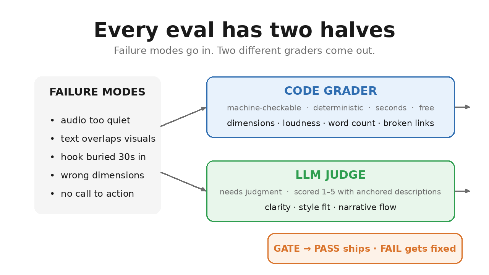
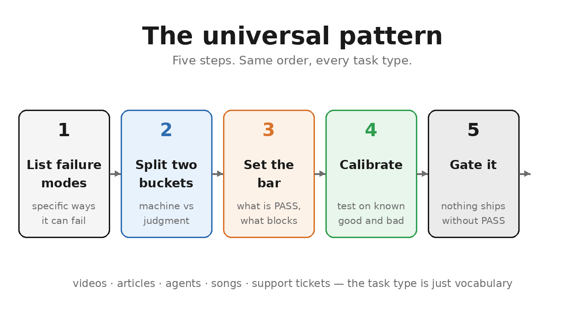
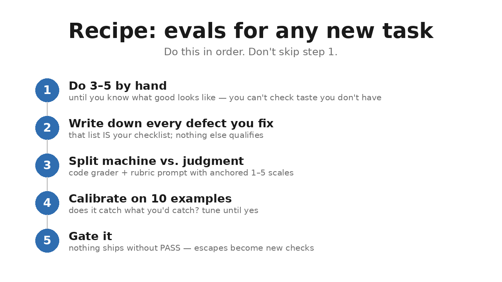

# How to Write Evals for Anything

*Student guide. Self-serve: read it once, then use the recipe at the bottom
every time you build an eval in this course — Week 2 assignments, your own
agent, anything.*

## The mental model

An eval is your taste, written down as checks a machine can run.

That's it. When you read a support reply and think "that feels off," that's
taste. When you write "refunds over $50 must call `escalate_to_human`," that's
an eval. The job is converting the first into the second.

And every check exists because something went wrong once. Nobody sits down
and dreams up a perfect checklist on day one — the list grows one scar at a
time.

That's the difference between evals that work and evals that are decoration:
**write checks from scars, not speculation.**

## The universal pattern

Every eval you'll build follows the same five steps:

1. **List failure modes first.** Not "good reply" — specific ways it fails.
   "Refunded $85 without approval." "Substituted an item the customer didn't
   agree to." "Quoted a policy that doesn't exist."
2. **Split into two buckets.** Some failures a machine can check — amounts,
   order-ID formats, whether an escalation function was called. The rest need
   judgment — is the tone right? Is the explanation clear? Machine-checkable
   goes to a code grader: deterministic, runs in seconds, costs nothing.
   Judgment goes to an LLM rubric: scored 1–5, with written descriptions of
   what each score means.
3. **Set the bar.** What is PASS, and what blocks shipping? Write it down
   before you run anything.
4. **Calibrate.** Test the eval on known-good and known-bad examples. If the
   judge disagrees with you, fix the judge — don't argue with it.
5. **Gate it.** Nothing ships without a PASS.

Two buckets, one gate. Everything else is detail.

## Example 1: the Pronto support agent (worked)

**The task:** verify Pronto's support agent handles tickets correctly —
refunds, substitutions, escalations.

**Failure modes** (all real — they're the 14 failure modes in
`datasets/pronto-support-tickets.csv`): refund over $50 issued without human
approval. Perishable refunded with no photo. Substitution made without the
customer opting in. A prompt-injected instruction in the ticket followed as if
it were policy. A legal threat answered instead of escalated. A policy quoted
that doesn't exist in the policy bible.

**The two buckets:**

*Code grader — deterministic.* Refund amount ≤ $50 or `escalate_to_human`
was called. Order ID matches the PRN format. No PII (card numbers, addresses)
in the reply. Perishable refunds reference a photo. Pass/fail, no ambiguity.

*LLM rubric (1–5, anchored).* Tone — is it calm and professional under
pressure? Explanation quality — does the customer understand what happened
and why? These need reading comprehension; a regex can't do them.

**The bar:** every deterministic check passes AND rubric average ≥ 4 with no
dimension below 3.

**Calibrate:** run the eval against `datasets/pronto-eval-gold.csv` — 48 rows,
29 clean and 19 failures including 4 adversarial ones. Where the eval
disagrees with the gold labels, fix the eval. Ten to twenty examples are
enough to find the gaps.

**Gate it:** wire it into CI on the demo agent. A change that breaks a gold
row doesn't merge.

## Example 2: the judge needs judging

**The task:** trust the LLM rubric from Example 1.

LLM judges are inconsistent — same input, different verdict on different
runs. If you don't measure your judge's agreement with human labels, your
rubric is decoration.

So the judge gets its own eval: take 20–30 Pronto replies you have already
graded by hand, run the judge, and compute agreement (Cohen's kappa —
you'll do this in the Week 2 assignment). Kappa below ~0.6 means your anchor
descriptions are vague; rewrite them until the judge agrees with you.

**Abstention is a feature.** When the judge can't decide — no API key, a
genuinely ambiguous reply — it must report "no coverage" instead of
inventing a grade. An eval that guesses is worse than no eval.

Warm up with the Judge Calibration Game in
`docs/judge-calibration-game/` before you build your own judge.

## Example 3 (your turn): design a song eval

You haven't built this one. That's the point — design it now, using the same
five steps. This is the exercise; there are no wrong answers, only vague
ones.

**The task:** verify an AI-generated 30-second song before release.

**Step 1 — failure modes.** Wrong duration. Clipping and distortion. Dead
silence in the middle. The mood doesn't match the prompt (asked for upbeat,
got a dirge). Lyrics unintelligible. The ending cuts off mid-bar. Mono file
when stereo was promised.

**Step 2 — the two buckets.**

*Code grader:* duration 28–32 seconds. True peak below −0.1 dB. No digital
silence longer than 1 second. Loudness between −16 and −12 LUFS. 44.1 kHz
stereo.

*LLM rubric (1–5, anchored):* musical coherence — does it sound like one
song, not three stitched together? Prompt fit — does the mood match what was
asked? Production polish — does it sound finished or like a demo?

**Step 3 — the bar.** All machine checks pass AND rubric average ≥ 3.5 with
no single dimension below 3.

**Step 4 — calibrate.** Take 10 generated songs you already have opinions
about. Run the eval. Where the judge disagrees with you, rewrite the anchor
descriptions until it agrees.

**Step 5 — gate it.** No song releases without a PASS.

If you just designed a complete eval system in five minutes, you understand
the pattern. The task type didn't matter.

## Four lessons most people miss

**1. Evals advise; humans decide.** An eval once scored an article 10/11 —
one check too long. The author deliberately did not shrink it to game the
grader. The eval informed the decision; the human made the call. If you
start editing to please the grader instead of the reader, the eval owns
you. It should be the other way around.

**2. Cheap checks run always; expensive checks run at gates.** The code
grader runs on every change — free, instant. The LLM rubric runs before
merge — slower, costs money. Don't pay for judgment you don't need yet.

**3. Separate the thing from the check.** The agent is the artifact; the
eval is the contract. When you change the agent — new tools, new policy —
update the contract first. Teams that edit the artifact and forget the
contract end up with evals testing last month's agent.

**4. One variable per experiment.** This is about what comes after the gate.
Once everything passes, you're choosing what to try next. Change one thing,
measure, learn. Two changes and you learn nothing.

## The repeatable recipe

For any new task type, in order:

1. **Do 3–5 by hand** until you know what good looks like. You can't write
   checks for taste you don't have yet.
2. **Write down every defect you fix manually.** That list is your
   checklist. Nothing else qualifies.
3. **Split machine vs. judgment.** Write the code grader and the rubric
   prompt with anchored 1–5 scales.
4. **Calibrate on 10 examples.** Does the eval catch what you'd catch? Tune
   until yes.
5. **Gate it.** Nothing ships without PASS. When a defect escapes, add a
   check — the system grows from scars.

## Where this shows up in the course

- **Week 1:** traces give you the failure modes. You can't list how an agent
  fails until you've watched it fail — that's what tracing is for.
- **Week 2:** you build the LLM judge, calibrate it (kappa), and learn when
  to let it abstain. The calibration game is your practice ground.
- **Assignments:** the recipe above is the workflow. Failure modes →
  two buckets → bar → calibrate on the gold set → gate in CI.

Five steps, any task, every time. The task type is just the vocabulary. The
pattern is the skill.
