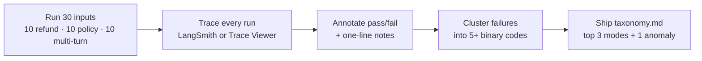

# Week 1 — Eval Foundations & Error Analysis

Why AI products need evals, the six quality dimensions, and the error-analysis
workflow that turns production failures into datasets.

**This page is the week's entry point.** The assignments themselves live —
complete, in one file each — in their READMEs:

- **[Assignment 1 — Instrument and trace](assignments/01-instrument-and-trace/README.md)** —
  wire up tracing, run the 30 inputs in `inputs.json`, annotate pass/fail.
  The README contains the full judging rules: the pass/fail decision table,
  turn-level vs trace-level evaluation, the stateless-agent warning, the
  CSV format, and what a good annotation contains.
- **[Assignment 2 — Build a failure taxonomy](assignments/02-failure-taxonomy/README.md)** —
  cluster your Assignment 1 failures into 5+ binary codes, count them, map
  them to quality dimensions, report the top 3 modes + 1 anomaly.
- **[Student clarity guide](student-clarity-guide.md)** — background only:
  glossary (traces / spans / turns / annotations), what regex does in this
  course, and setup & troubleshooting. The judging rules that used to live
  there now live in the assignment READMEs above.
- **Tooling:** [Trace Viewer documentation](../../docs/trace-viewer/README.md)
  (input formats, local run, exporting from other tools) ·
  [LangSmith docs](https://docs.langchain.com/langsmith) ·
  [LangSmith concepts (traces, spans, runs)](https://docs.langchain.com/langsmith/observability-concepts)

> **Two paths through this week's hands-on work — pick one, both are legitimate.**
> **Path A — LangSmith** (recommended for engineers): follow Assignment 1's
> steps. Needs a `LANGSMITH_API_KEY` in your `.env`; traces land in the
> `ai-evals-course` project where you annotate them.
> **Path B — Trace Viewer** (zero setup): run `python export_otel.py` in the
> Assignment 1 folder — it replays all 30 inputs through the demo agent (no
> API key needed) and writes `pronto-traces.json`. Upload that file to the
> [Trace Viewer](https://coachmanjeet.github.io/AI-Agent-Evals-Course/trace-viewer/),
> annotate all 30 traces there, and export your annotations as JSON/CSV —
> that's your `annotations.csv` deliverable for Assignment 1.
>
> (The Trace Viewer's built-in "Load the Pronto sample" button loads a small
> 6-trace sample for trying the tool out. It is a demo, not the assignment —
> Assignment 1 requires all 30 traces, which is what `export_otel.py`
> produces.)
>
> Path B is a complete Week 1 experience — no key needed at all.
> **Braintrust is not required in Week 1** — it is required starting
> Week 2. From Week 2 on you'll also need an LLM API key (any provider —
> OpenAI, Anthropic, or Gemini; $5 is enough to start), so get one set up
> before then.

## This week's workflow

## Before you begin — 2 questions

Answer these now and keep your answers (pick a codename so it's anonymous but
yours). The same two questions come back in Week 6.

1. **On a scale of 1–10**, how confident are you that you could design an
   evaluation that tells you whether your AI feature is actually ready to ship?
2. **Scenario:** your AI agent demos beautifully, but real users keep complaining.
   What's your first move?

## What we covered

- Production failure case studies: how AI products actually break in the wild
- Model benchmarks vs. product evals (benchmarks don't measure your product)
- Non-determinism and how to approach it
- Traditional QA vs. AI evals; evals as core infrastructure
- The six quality dimensions: model quality, product behavior, safety, reliability, cost, latency
- Cost metrics: per-task cost tracking, token and retry accounting
- Latency metrics: time-to-first-token, span timing, percentile tracking
- Eval harness architecture and pipeline components
- Built a real customer-service agent (`agent/`) with logging and observability
- Traces vs. logs; the error-analysis workflow; failure taxonomies
- Frequency-based prioritization
- The eval flywheel: deploy → analyze → build dataset → improve → monitor

## Key takeaways

1. **Benchmarks measure models; evals measure your product.** A high MMLU score tells you nothing about your agent's refund flow.
2. **You can't improve what you can't see.** Tracing every run is the prerequisite for everything else in this course.
3. **Fix by frequency, not by loudness.** Failure taxonomies with counts beat anecdote-driven debugging.
4. **The flywheel is the product.** Deploy → analyze → dataset → improve → monitor is a loop, not a phase.

## Links

- LangSmith docs — tracing, datasets, annotation: https://docs.langchain.com/langsmith
- LangSmith concepts (traces, spans, runs): https://docs.langchain.com/langsmith/observability-concepts

## Tool: Trace Viewer

See the [Trace Viewer documentation](../../docs/trace-viewer/README.md) — input-format spec, local-run and export instructions live there.

## In this folder

- `assignments/01-instrument-and-trace/` — Assignment 1: wire up tracing, run 30 inputs, annotate traces (complete instructions in its README)
- `assignments/02-failure-taxonomy/` — Assignment 2: cluster failures into codes, report top modes (complete instructions in its README)
- `student-clarity-guide.md` — background: glossary, regex note, setup & troubleshooting
- `examples/` — method worked-examples (see its README for how examples differ from solutions)
