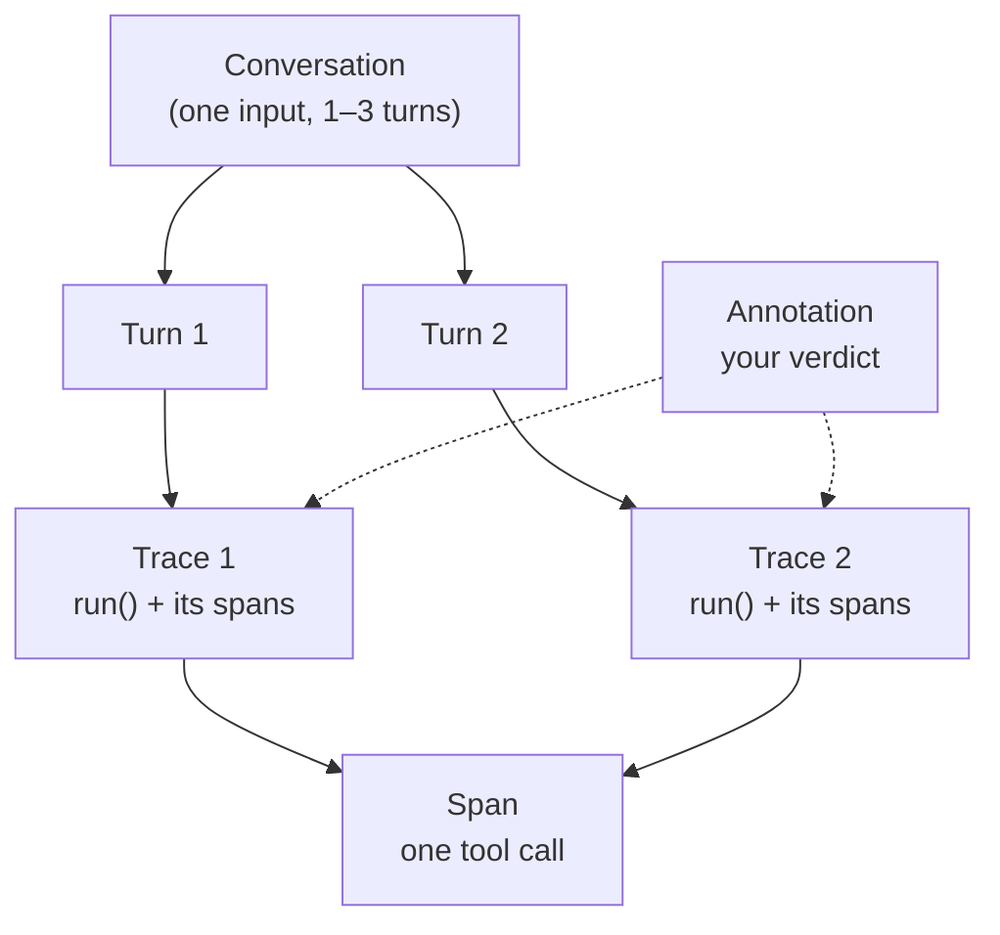

# Week 1 — Student Clarity Guide

This guide used to hold Week 1's judging rules. They now live **inside the
assignment READMEs**, where you need them while you work — each assignment
README is the one complete document for that assignment:

| What you need | Where it lives now |
|---|---|
| What to submit (Assignment 1) + required-vs-preview + API keys + week boundaries | [Assignment 1 README](assignments/01-instrument-and-trace/README.md) — "What to submit", "Which platform to use", "Week boundaries" |
| What to submit (Assignment 2) + "explicitly NOT required in Week 1" | [Assignment 2 README](assignments/02-failure-taxonomy/README.md) — "What to submit" |
| Pass/fail decision table (§3) | Assignment 1 README — "Pass/fail decision table" |
| Turn-level vs trace-level rule + `CONTEXT_LOSS` worked example (§4) | Assignment 1 README — "Turn-level vs trace-level evaluation" |
| Stateless-agent warning (§5) | Assignment 1 README — "The Week 1 agent is stateless" |
| Full CSV spec (§6) + good-annotation guidance (§8) | Assignment 1 README — "The CSV format", "What a good annotation contains" |

What remains in this file is background that doesn't belong to a single
assignment step: the glossary (§2), what regex is in this course (§7), and
setup & troubleshooting (§9). Those sections are unchanged.

---

## 2. Glossary: traces, spans, turns, annotations

| Term | What it is | Example |
|------|-----------|---------|
| **Turn** | One user message + the agent's reply | "Where is my order PRN-10421?" → "Out for delivery…" |
| **Trace** | The recorded execution of one `agent.run()` call — the root span plus everything it called | Turn 2's trace shows `run()` → `issue_refund()` → `escalate_to_human()` |
| **Span** | One unit of work inside a trace (a tool call, an LLM call) | The `issue_refund` span shows its inputs, outputs, and timing |
| **Annotation** | A label **you** attach to a trace (or span): pass/fail, failure code, evidence | `FAIL · NO_AUTH · "revealed address without order ID" (span: run, output line 1)` |

How they relate:



**The CSV row is per conversation; the trace is per turn.** Your 30 CSV rows each
cover one input (which may be multi-turn). Inside LangSmith / the Trace Viewer
you will see one trace per turn. Your `pass_fail` is the verdict on the whole
conversation; use the `note` to record what happened turn by turn (see the
Assignment 1 README, "Turn-level vs trace-level evaluation").

---

## 7. What regex is (and isn't) in this course

Regex appears in **the agent's logic**, not in the evaluation method:

- `re.search(r"PRN-\d+", ...)` — extracts an order ID from the user's message
- `re.search(r"\$?\s*(\d+(?:\.\d{1,2})?)", ...)` — extracts a dollar amount

That is it. Regex is how this tiny demo agent parses inputs. It is **not** how
you evaluate the agent — you evaluate by reading traces and annotating
pass/fail like a human reviewer. (Programmatic checks as eval baselines arrive
in Week 2, when you build code-based evaluators alongside LLM judges.)

Limits worth knowing: the patterns are brittle by design (e.g. they miss
"order number 10421" without the PRN- prefix). If you spot such a miss in a
trace, annotate it — that's error analysis working as intended.

---

## 9. Setup & troubleshooting

Prereqs: **Python 3.10+** (3.10, 3.11, 3.12, 3.13 all fine), 4 GB RAM,
Mac / Windows / Linux.

```bash
python3 --version          # must be 3.10+
python3 -m venv .venv && source .venv/bin/activate   # Windows: .venv\Scripts\activate
pip install -r requirements.txt   # or: make setup
```

Common problems:

| Symptom | Fix |
|---------|-----|
| `pip install` fails on Rust / `maturin` / compiler errors | Upgrade pip first: `pip install -U pip`, then rerun. If a single package fails, `pip install <package> --only-binary :all:` |
| `python` opens the Windows Store | Use `python3`, or enable the Python "app execution alias" off in Windows Settings |
| `ModuleNotFoundError: langsmith` | Your venv isn't active, or `make setup` didn't finish — look for the `[3/3]` line |
| LangSmith 401 | Check `LANGSMITH_API_KEY` in `.env` (never committed — that's the point); project must be named `ai-evals-course` |
| Traces don't appear | The `@traceable` decorators aren't wired yet — that's Assignment 1, step 1 |
| `make agent` fails | Run `make setup` first and let it finish (3–5 min, don't Ctrl-C) |
| Judge game API errors (Week 2) | 401 → check the key; 429 → wait 30s; anything else → `?mock=1` for keyless practice |

**Smoke test** (after `make setup`): `make agent` should print a demo reply
with no API key. If it does, your environment works.

**Fallback path:** if setup will not cooperate, use **Path B** (Trace Viewer) —
it needs no install at all: run `python export_otel.py` in the assignment
folder (stdlib only), upload the JSON to the Trace Viewer, annotate in your
browser. Full credit, zero setup.
