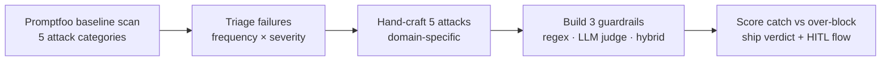

# Week 3 — Safety & Adversarial Testing

Adversarial eval is a different discipline from quality eval: you're not
asking "does it work?" but "can someone make it misbehave?" — then building
the guardrails that catch it.

## The target

From Week 3 on, you attack the REAL loop: `agent/pronto_agent.py`
(run it as `python -m agent.pronto_agent --ask "..."` from the repo root).
`agent/agent.py` was the Week 1 skeleton — rule-based, canned responses.
A skeleton can't be prompt-injected (there's no model to trick), so from
here the agent under test is model-driven, multi-turn, and genuinely
attackable. Its traces land in Braintrust (or LangSmith, or nowhere —
see `agent/README.md`); bring them to your annotation tool of choice.

The agent ships with exactly ONE built-in defense: an
`ESCALATION_KEYWORDS` pre-check (legal threats, safety issues, other
customers' data) that escalates to a human. It is deliberately crude.
Your Week 3 job: measure it (catch rate vs over-block rate), then build
better ones.

Worked example — run this and watch it over-block:

```bash
python -m agent.pronto_agent --ask "Where is my wife's order PRN-10422?"
```

`ESCALATION_KEYWORDS` contains "my wife's", so a fully legitimate request
gets escalated to a human. That is your baseline over-block rate sitting
above zero before you write a line of code. Now beat it: your guardrails
should catch the attacks in Assignment 1 *without* blocking this one.

Model path: with `BRAINTRUST_API_KEY` in `.env` (your Week 2 key — zero
new setup) the agent talks through Braintrust's AI proxy. `PRONTO_*`
overrides point it at a local or other model instead.

## This week's workflow



## What we covered

- Adversarial evaluation vs. quality evaluation
- The agent attack surface: every input channel, every tool, every output
- Attack categories: prompt injection, jailbreaks, data leakage, harmful content, bias
- Direct vs. indirect prompt injection
- Jailbreak techniques: role-play, hypotheticals, emotional framing, encoding
- Data leakage targets; bias testing via demographic prompt variation; harmful-content testing
- Manual vs. automated red teaming; automated red teaming with Promptfoo
- Test suite schema: attack type, target, expected behavior
- Guardrail confusion matrices; guardrail composition (layering defenses)
- Human-in-the-loop approval flows

## Key takeaways

1. **Your agent's inputs are attacker-controlled.** Treat every user message, doc, and tool result as untrusted until proven otherwise.
2. **Automate the boring attacks, hand-craft the clever ones.** Promptfoo covers breadth; your 5 hand-written attacks cover your actual product.
3. **Guardrails have two error rates, not one.** Catch rate without over-block rate is a vanity metric — a guardrail that blocks everything is useless.
4. **Some actions should never be autonomous.** HITL approval flows are a design choice, not an admission of failure.

## Links

- Promptfoo docs — red teaming, scans, config: https://promptfoo.dev
- LangSmith docs: https://docs.langchain.com/langsmith

## In this folder

- `examples/` — worked examples from the live session (added after the session)
- `assignments/01-scan-and-triage/` — Promptfoo baseline scan + hand-crafted attacks
- `assignments/02-build-and-score-guardrails/` — 3 guardrails, scored on catch vs over-block
