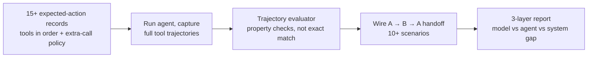

# Week 5 — Multi-Agent Evaluation

Single-agent evals stop being enough the moment agents use tools, keep memory,
and hand work to each other. This week: score the trajectory, not just the answer.

## This week's workflow

## What we covered

- Agent eval foundations: model vs. agent vs. system (three different things to score)
- Agent failure modes: tool misuse, reasoning loops, memory drift, permission escalation, coordination conflict
- Turn-level vs. conversation-level metrics
- Tool-call scoring; expected-action sets
- Argument validation as structured-output evaluation
- Trajectory evaluation: the path matters, not just the destination
- Property-based trajectory judging vs. exact-match diffs
- Multi-agent coordination: handoff evaluation (completeness, fidelity, routing)
- Cascading failures in agent pipelines
- Model→system score gaps as interaction-failure signals

## Key takeaways

1. **Score at three layers.** A great model can still produce a failing system — the gap between model score and system score is where the bugs live.
2. **Judge properties, not exact paths.** There are many good trajectories; check invariants (right tools, right order, no extra calls) instead of exact matching.
3. **Handoffs are where multi-agent systems die.** Completeness, fidelity, routing — evaluate each handoff like a contract.
4. **Flag fragile passes.** A pass that succeeded for the wrong reason is a future incident with a timestamp.

## Links

- LangSmith docs — tracing multi-step trajectories: https://docs.langchain.com/langsmith
- CrewAI docs — agents, tasks, crews, tools: https://docs.crewai.com

## Setup — model key + CrewAI

The Pronto crew runs on a real model (default `gpt-4o-mini`):

1. Put a model key in your `.env`: `OPENAI_API_KEY=<paste your key>` — or set `PRONTO_MODEL` to another model you have access to (the crew reads it in `pronto_crew.py`).
2. `pip install crewai` in your `.venv`.
3. Smoke-test from `assignments/`: `python pronto_crew.py "My strawberries from order PRN-10421 arrived moldy."` — the three agents work the request and the tool trajectory prints at the end.

## Assignments

Each assignment README is the complete assignment document (steps,
judging rules, acceptance criteria) — this page only links to them:

- [Assignment 1 — Score tools and trajectories](assignments/01-score-tools-and-trajectories/README.md) — expected-action records + trajectory evaluator
- [Assignment 2 — Find interaction failures](assignments/02-find-interaction-failures/README.md) — three-layer report + handoff root causes

## In this folder

- `examples/` — worked examples from the live session (added after the session)
- `assignments/pronto_crew.py` — the system under test: triage → policy → refund crew on CrewAI (`pip install crewai`)
- `assignments/01-score-tools-and-trajectories/` — expected-action records + trajectory evaluator
- `assignments/02-find-interaction-failures/` — three-layer report + handoff root causes
